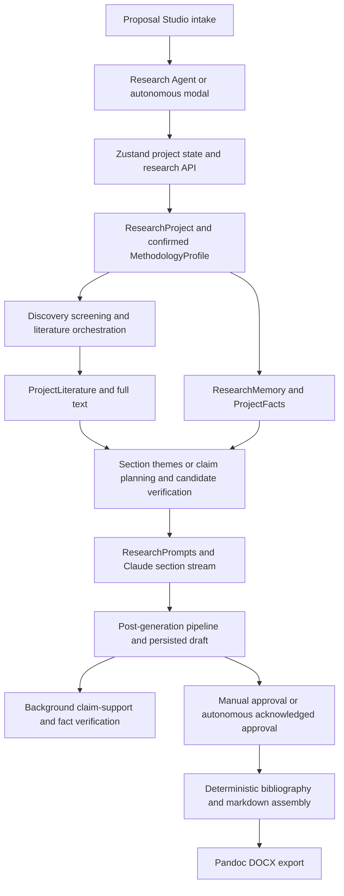

# Proposal Studio architecture assessment

Historical assessment. Implementation has since progressed; see the [current implementation status](proposal-engine-implementation-status.md).

Assessment date: 3 October 2026. Scope: the Humaniser frontend and the sibling Humaniser API repository. This is a source inspection, not an implementation or a live production/database audit. No application code was changed and no tests were executed. Classification describes the inspected source; deployment configuration and external-provider availability remain unverified.

Frontend paths below are relative to Humaniser-frontend. Backend paths are relative to Humaniser. Backend service names resolve under `HumaniseAI.Infrastructure/Services/`, entities under `HumaniseAI.Domain/Entities/`, and interfaces under `HumaniseAI.Application/Services/`, unless otherwise specified. Line anchors describe the inspected working tree and may move.

CodeGraph was used first in the frontend. The backend index could not open its database; backend findings come from direct source inspection. Existing untracked backend files were left untouched.

## A. Current architecture

### Entry points and frontend state

`src/pages/app/ProposalStudioPage.tsx:165` is a dashboard combining research projects, studio entries and library documents. Its guided creation action navigates to `/app/research-agent/new`; manual entries open the document editor. `src/api/studio.ts` and backend `StudioController` implement workspace-entry CRUD, not academic generation. A `StudioDocument` should not be mistaken for a research specification or generated proposal aggregate.

Guided proposal writing lives in `src/pages/app/ResearchAgentPage.tsx`: project bootstrap at line 4960, methodology confirmation around 1105, literature gathering around 1445, chapter writing around 3596, and download at 2003. The screenshot is this Research Agent download step. `DownloadStep` groups warnings by section; the displayed `(5)` is the number of affected sections, not the total number of individual citation issues. Its copy explicitly makes review optional at line 2282.

`src/store/researchStore.ts:225` creates projects; `syncProject` at 258 sends full wizard state through `src/api/research.ts` to the backend. Sections also have separate fetch/save/approve APIs. Zustand state therefore coexists with backend section entities and wizard `sectionContent` JSON. `src/data/proposalOutline.ts` defines frontend step/section metadata separately from backend definitions.

Autonomous creation is in `src/components/app/AutonomousProposalTools.tsx`, especially `useAutonomousProposalFlow` at 710 and `handleCreate` around 838. It creates a project, stores setup values and a per-section target, synchronizes it, starts a server job, then polls persisted progress. It divides total requested words evenly by the frontend section count, with a 150-word minimum.

**Confirmed startup mismatch:** the modal's configuration has no methodology confirmation, and `handleCreate` never calls `confirmMethodology`. Backend `ResearchService.StartAutonomousGenerationAsync:12079` requires `CurrentMethodologyProfileId`. A newly created project from this modal cannot satisfy that prerequisite. The UI catches startup failures with a generic server-running message, obscuring the actual prerequisite. This is a source-level mismatch; it was not reproduced against a running server.

### API and application orchestration

`HumaniseAI.API/Controllers/ResearchController.cs` exposes project-scoped operations under `/api/v1/research/projects/{projectId}`:

| Operation | Endpoint suffix / implementation |
|---|---|
| Intake | project create/get/PATCH; `ResearchService.CreateAsync:150`, `UpdateAsync:319` |
| Topic and title | `generate-topics`, `generate-titles`; methods at 450 and 555 |
| Methodology | `methodology-recommendation`, `methodology/confirm`, `methodology/change-impact`; methods at 638, 217, 292 |
| Section lifecycle | `sections/init`, `sections/generate`, `sections/regenerate`, section PATCH, `sections/approve` |
| Autonomous generation | `generate-autonomous`, `generation-status`, `generation/cancel` |
| Structured planning | research-question/objective CRUD, hypothesis generation, analysis-plan retrieval |
| Evidence | literature fetch/inclusion, discovery configuration and jobs, screening and corpus approval |
| Review | alignment, quality, Chapter 4 validation, citation flags/fixes, fact conflicts |
| Output | `compile-bibliography`, `export-docx` |

The main orchestration is concentrated in the approximately 16,500-line `ResearchService.cs`. It handles setup, discovery integration, prompts, generation, citation repair, validation, approval, thesis transition and export.

### Persistent research configuration

`ResearchProject` stores title/topic, academic level/field, geography/population, citation style, setup JSON, literature gap, job progress, corpus approval and document/research states. It contains overlapping legacy fields such as `Title`/`ChosenTitle`, document enum/string values, and `SectionContentJson` alongside `ProjectSection` rows.

`MethodologyProfile` is an immutable, explicitly confirmed versioned record containing approach, subtype, design, time horizon, collection and analysis approaches. `GenerationContextBuilder` prepends authoritative methodology and date instructions. Methodology-sensitive generation is blocked without confirmation; qualitative hypotheses are structurally excluded. Methodology changes mark affected content stale.

`CanonicalResearchPlan` is an immutable snapshot created at thesis transition by `CreateCanonicalResearchPlanSnapshotAsync:13216`. It copies title, question/objective arrays, design, sampling and methodology. It is not a proposal-time governing specification and does not cover all requested fields.

`ResearchMemoryProvider.GetContextAsync` selects section-derived context, hashes inputs, and uses `ResearchMemoryPrompts` plus Claude to distill questions, objectives, methodology, variables, geography and framework. Generation consumes selected memory fields plus `ProjectFact` context. Refresh failures or insufficient credits can return old/placeholder memory. The memory is a useful derived cache, but currently generated prose contributes to the context used to generate later prose.

### Literature, evidence and LLM calls

`FetchRealLiteratureAsync:1080` integrates existing literature retrieval. `LiteratureOrchestrator` and `LiteratureDistillationJob` provide broad retrieval/distillation. Project discovery uses `ResearchLiteratureDiscoveryService`/job and existing scholarly database providers; `ResearchScreeningService`/job provides screening and corpus approval. `ProjectLiterature` retains bibliographic identity, inclusion, provenance and source text. `ProjectLiteratureFullTextService` supports full text. `LiteratureRetrievalService.RetrieveGroundedPassagesAsync` queries project-scoped pgvector embeddings; similarity ranks candidates rather than proving support.

`GenerateSectionAsync:4482` is shared by manual and autonomous generation. It checks ownership, confirmed methodology, section applicability, research state and credits; loads memory/facts; selects literature; performs bounded retrieval/top-ups and methodology-anchor resolution; builds a section-specific prompt; streams Claude output; runs post-generation processing; persists a draft and schedules verification.

For selected codes, `PlanSectionClaimsAsync:2669` plans claims before writing. `UsesClaimLevelEvidenceRetrieval:2438` includes introduction, framework and several methodology sections, but does not include literature review 2.0 or problem statement 3.1. Other paths use section themes. Candidate scoring and matching are followed by `PreVerifyClaimEvidenceAsync:2780`, which calls `CitationClaimSupportVerifier` and optionally the deterministic `ClaimEvidenceSelectionGate`/`ClaimEvidenceGate`/`ClaimEvidenceCombiner`.

This substantially supports claim -> retrieve -> select -> verify -> write -> cite, but does not enforce that chain across the whole proposal:

- Pre-verification exceptions return null and preserve unverified selection.
- `ApplyClaimEvidenceGateAsync:2899` restores semantic-only candidates if the deterministic gate would remove the whole section's set, or if the gate fails.
- Acceptance is aggregated by literature ID, rather than exclusively by the exact claim-source pair.
- At 5410-5447, the verified map is passed alongside a broader `literature` pool. That broader pool is deliberately not restricted to claim-bound sources.
- `ClaimPlanJson` is a generation audit artifact, not a durable approved plan reused as a prerequisite.

`ResearchPrompts.GetSectionPrompt:940` holds section-specific system/user prompts, citation rules, methodology overrides and approximate word targets. Prompts also live in `ResearchMemoryPrompts`, `ValidationPrompts`, `GraphPrompts` and inline methods such as analysis-plan generation. `ClaudeService.CompleteAsync:528` and `CompleteStreamAsync` execute buffered/streamed calls through existing transport, retry, cost and telemetry infrastructure. The inspected generic buffered call does not supply a task-specific prompt version. `PromptVersions` has capability-level identifiers; that is not a historical version of each proposal-stage prompt.

### Questions, methodology and post-generation checks

Questions/objectives are generated as sections 4.1/4.3. Typed `ProjectResearchQuestion` and `ProjectObjective` records and CRUD exist. `ResearchQuestionSync` and `ObjectiveSync` parse numbered prose and upsert typed records for downstream consumers. Their nullable reciprocal number links are not populated by these parsers. Removed questions can remain as rows; later prose synchronization can overwrite CRUD edits. Graph infrastructure includes LLM-assisted objective/question links, but it is not a mandatory accepted research-plan relation.

Hypotheses have a dedicated typed generation/prose path. `AutonomousChapterCodes.Ordered` has 25 codes and explicitly excludes hypotheses 4.4; it also does not generate abstract 0.0. `GenerateAnalysisPlanInternalAsync:12957` generates methodology-aware plans from objective prose. `ProjectAnalysisPlan` contains textual objective/variables/test fields, rather than mandatory objective, variable and data-source relations.

`RunPostGenerationPipelineAsync:6751` performs shared cleaning, reference/citation checks, facts processing and usage synchronization. `CitationClaimSupportVerifier` assesses semantic support, provenance, geography, population and scope using metadata, abstracts and available full-text excerpts, recording evidence coverage. Its full-text excerpt is bounded to 1,500 words; presence of full text does not establish that the relevant passage was examined. `CitationClaimSupportVerificationJob` and `FactsConsistencyVerificationJob` perform asynchronous checks. A draft may be approved before these finish.

`FactsConsistencyChecker`, `EligibilityConsistencyChecker`, `ResearchGeographyAlignment`, `MethodologyRuleChecker` and `MethodologyConsistencyVerifier` already address significant parts of consistency. `ValidateAlignmentAsync:10495` inspects only the first 600 characters per section. `ValidateProposalQualityAsync:10572` uses head/tail excerpts and merges some deterministic findings. Both return `IsValid=true` on LLM failure or parsing failure; those early returns can also skip subsequent deterministic findings.

`ValidationService` persists structural and relational results with content hashes. It checks methodology anchors, sample-size bands, sample/data alignment and LLM-assessed methodology/objective coverage. Its quantitative sample adequacy rule uses bands below 30, 30-99 and at least 100; this is not a design-specific power/precision calculation. Its whole-proposal source count in `ResearchService` counts distinct corpus DOIs, not distinct actually cited supported works, despite its message saying sources are cited.

`ResearchWorkflowEvaluator` exists as a shadow completion evaluator. Its proposal stage is not independently evaluable and its `RequireAsync` is not wired into live gates in the inspected phase. It is reusable groundwork, not an active proposal readiness authority.

### Jobs, persistence and final document

`SectionGenerationJob` runs one manual generation attempt with no automatic retries. `ProposalGenerationJob` iterates ordered sections, resumes existing content, persists progress, uses bounded continuations, supports cancellation and updates a heartbeat. It calls `ApproveSectionAsync(... acknowledgeConflicts: true)`. That approval branch dismisses open fact, gap and integrity flags. Job completion consequently means processing finished, not evidence-safe academic readiness.

`AppDbContext` and EF configurations/migrations persist projects, sections/versions, literature, evidence decisions, questions/objectives/hypotheses, analysis plans, methodology profiles, validation, memory and logs in PostgreSQL. Hangfire uses PostgreSQL storage with separate queues and stale-run reconciliation configured in `HumaniseAI.API/Program.cs`. Existing uniqueness/upsert/advisory-lock patterns address several races; they are not a complete immutable input/run provenance model.

`CompileBibliographyDeterministic:15791` resolves cited works against the canonical project registry and handles deduplication/disambiguation. `CompileBibliographyAsync` actually returns an empty unresolved-registry result when nothing resolves; nearby comments mentioning an LLM fallback are stale and must not be treated as current behavior.

`ExportPartialDocxAsync:11894` merges entity content with legacy wizard JSON, with entities taking precedence, includes draft-or-later sections, assembles markdown and calls `ConvertWithPandocAsync`. It checks methodology contradictions/staleness, but catches citation/fact blockers and proceeds by explicit existing product policy. This explains the screenshot. Exportability and academic readiness are different concepts today.

### End-to-end trace

The current engine already generates section by section. A new monolithic proposal prompt would regress its architecture.

## B. Gap analysis

Status is measured against the requested production behavior, not merely whether a similarly named class exists. BROKEN denotes a concrete code-path mismatch or unsafe validity contract, not a claimed live incident.

| Target capability | Status | Evidence and remaining gap |
|---|---|---|
| Guided proposal intake | EXISTS | Research Agent setup and project API; richer intake still needed |
| Autonomous intake/start | BROKEN | Modal omits required methodology confirmation |
| Governing ResearchSpecification | PARTIAL | Project fields/profile/transition snapshot exist; no comprehensive proposal-time approved revision |
| Literature retrieval | EXISTS | Provider reuse, orchestration, discovery, screening, vector retrieval |
| Durable evidence map | PARTIAL | Claim/section decisions, embeddings and EvidenceUnit exist; not a universal claim-bound proposal prerequisite |
| Evidence-grounded research gap | PARTIAL | Gap extracted from generated 2.0; no accepted gap dossier tied to search coverage/counterevidence |
| Questions and objectives | PARTIAL | Typed CRUD, prose parsers and graph links; mandatory accepted mapping absent |
| Methodology design/consistency | PARTIAL | Strong confirmed profiles and deterministic/semantic checks; overall invariant graph incomplete |
| Geography and population consistency | PARTIAL | Setup fields, identity/scope checking; no comprehensive revision invalidation |
| Section planning | PARTIAL | Fixed outlines and per-run claim plans; no accepted dependency-aware section contracts |
| Section generation | EXISTS | Shared queued section generation and streaming |
| Claim-source support verification | PARTIAL | Real semantic/deterministic infrastructure; advisory broader pool and fallback behavior |
| Citation identity/bibliography | PARTIAL | Canonical resolver/compiler work; draft/export can contain unresolved citations |
| Validation failure semantics | BROKEN | Alignment/quality fail or malformed output returns valid |
| Cross-section audit | PARTIAL | Fact conflicts, methodology rules and excerpt review; full dependency consistency absent |
| Examiner review | PARTIAL | Quality, thesis audit and examiner/defence prompts; no required version-bound proposal review artifact |
| Sample-size justification | PARTIAL | Generation guidance and size bands; structured validated calculation absent |
| Statistical-method alignment | PARTIAL | Generated analysis plans; no enforced objective-variable-scale-design-test graph |
| Scope and feasibility control | PARTIAL | Breadth/timeline/staffing warnings; no intake-level accepted feasibility contract |
| Reproducibility | PARTIAL | Section versions, decisions/context and AI logs; no complete input/prompt/model/corpus run linkage |
| Proposal prompt versioning | PARTIAL | Capability version infrastructure; stage-specific hashes and audit linkage absent |
| Word-count enforcement | PARTIAL | Counts, approximate targets and token guards; no weighted global budget and bounded correction contract |
| Institutional requirements | PARTIAL | Template entities and project selection; project model explicitly notes generation does not consume them yet |
| Persistence/background execution | EXISTS | EF/PostgreSQL and Hangfire infrastructure; stronger concurrency/checkpoint provenance needed |
| Authoritative readiness policy | MISSING | Shadow evaluator cannot assess proposal; approval/export/completion have different meanings |
| State/outline authority | DUPLICATED | Wizard JSON/entity prose, overlapping project fields, frontend/backend outline metadata |

## C. Root causes

1. **Prose is upstream of research decisions.** Questions, objectives, gaps and memory are often derived after prose generation. Early mistakes become later context rather than failing a prior research-contract check.
2. **Multiple writable authorities.** Legacy JSON, section entities, typed CRUD, prose synchronization, scratch methodology and confirmed profiles need explicit ownership and precedence.
3. **Warnings, waivers and verification are conflated.** Acknowledgement can dismiss an integrity problem; automation uses that override; successful download or job completion can look like readiness.
4. **Verification is not a durable barrier.** Background assessment and permissive fallbacks permit writing/approval while support is unknown. Broad source access weakens claim-specific pre-verification.
5. **Validators lack a shared dependency contract.** Excerpts, thresholds, cached checks and shadow completion independently answer related questions; stale and unavailable states are sometimes treated as success.
6. **Linearity substitutes for dependency planning.** Section order is fixed while scientific dependencies should be resolved before prose, regardless of final document order.
7. **Audit data is fragmented.** Logs record memory or model usage, but not a single immutable research/corpus/prompt snapshot behind each result.

## D. Reuse plan

Keep the current React design system, Proposal Studio dashboard, Research Agent editor/rail, evidence/citation drawers, generation streams and store/API patterns. Add structured intake/review views using those components.

Keep `ResearchProject` as the aggregate; extend its canonical plan/profile machinery. Reuse typed questions/objectives/hypotheses, analysis plans and section history. Convert `ResearchMemory` into a derived projection of accepted structured state, retaining its summarization usefulness.

Reuse literature providers, `LiteratureOrchestrator`, project discovery/screening, full-text acquisition, embeddings, canonical identities and methodology anchors. Do not build another scholarly-search or DOI service.

Reuse the existing claim verifier, deterministic gates, fact/eligibility/geography/methodology checkers and validation persistence. Generalize the located-passage `EvidenceUnit` and staged `LiteratureReviewGenerationService` contracts where compatible; do not create a second evidence store. `EvidenceSpan` is screening-decision-scoped and cannot be used as a proposal claim relation without an adapter.

Keep Claude transport/router/cost controls, AI logs, credit reservation, Hangfire queues/reconciliation, bibliography compilation and Pandoc export. Extract cohesive capabilities from ResearchService incrementally behind its existing interface.

## E. Minimum target architecture

Use the existing modular backend and database; no new microservices are required.

A lightweight proposal workflow coordinator sequences existing capabilities and persists checkpoints. A specification resolver supplies an immutable approved revision to every generation/review operation. A shared readiness evaluator computes barriers, freshness and applicability from evidence, never from progress percentages alone.

ResearchSpecification is a single logical authority implemented through a versioned canonical snapshot and stable references to existing records. Unknown fields remain explicit unknowns. LLMs may propose decisions; confirmation accepts them. Derived prose and summaries cannot silently replace accepted decisions.

Require explicit relationships from problem -> evidence -> gap -> questions -> objectives -> framework -> methods -> constructs -> data -> analysis -> contribution/limitations. Qualitative, quantitative and mixed-method branches have different applicable contracts; no universal hypothesis or statistical-test requirement.

Use generation order distinct from display order: establish the research problem/evidence/gap and question-method plan before writing all dependent sections; write abstract last. Persist a request's specification revision, evidence/corpus revision and section contract. An upstream revision invalidates only affected descendants. Do not overwrite a newer student edit when an older job finishes.

Preserve downloadable drafts. Introduce an explicit, stricter **submission-ready** result requiring current verification and no unresolved blocking findings. Legacy export remains draft-compatible; a separate finalization command must not silently inherit its permissive policy. Automation stops at NeedsReview/Blocked and cannot impersonate student waivers.

## F. Data model changes

These are proposed additive migrations, not implemented schema.

| Existing/new model | Minimum changes |
|---|---|
| CanonicalResearchPlan -> specification revisions | Extend with schema version, topic/problem, level/field, geography, population/unit, temporal scope, framework, data sources, sampling/analysis, citation style, institution requirements, scope limits, contribution and limitations. Retain question/objective snapshot contents; reference accepted methodology version and stable child IDs. Preserve old snapshot meaning/reason. Expose as ResearchSpecification DTO rather than a competing mutable table. |
| ResearchProject | Current accepted specification revision pointer, concurrency token, policy version. Legacy fields become compatibility projections; confirmation remains explicit. |
| Questions/objectives | Stable same-project relationships, revision membership and retired status. Use a relation table if many-to-many mapping is needed; numbers are display labels. Prose scraping becomes a legacy import operation requiring reconciliation. |
| Hypotheses/analysis plans | Link objectives, constructs, data sources and method steps by IDs. Store measurement scale, unit, design assumptions, missing-data handling and intended qualitative/mixed-method steps without repurposing inferential-test text as the only schema. |
| Construct/data/sampling records | Typed operational definitions, roles/scales/source IDs; sampling frame; justification kind and inputs. Store quantitative power/precision assumptions, formula/library version, result and rounding; qualitative saturation/information-power rationale remains an assessable rationale. |
| EvidenceUnit / existing decision records | Specification/corpus/claim-plan revision, immutable passage locator/hash, coverage, exact claim/proposition relationship and verdict versions. Retain bibliographic fields solely in the source registry. |
| GapAssessment | Candidate gap/type, cited studies, counterevidence, scope, search-run/query/date/provider references, coverage limitations and review status. Absence from a retrieved set is not proof that research does not exist. |
| Section contract and generation run | Required fields/dependencies, allowed evidence bindings, word bounds, specification/corpus/rule/prompt versions; attempt IDs, idempotency key, checkpoints, result hash and expected prior section revision. |
| ValidationResult / review artifacts | Evaluated input fingerprint, rule/prompt version, severity, Pass/Fail/Warning/Unknown/Pending/Stale/NotApplicable, exact evidence locations, reviewer decision and actor. A waiver is distinct from Verified. |
| Existing AI/context logs | Run/project/section linkage, prompt template ID/version/hash, model parameters and immutable input/output references. Apply access controls/retention to sensitive prompts and source material. |

Add unique indexes for `(ProjectId, Version)` and run idempotency; enforce project-scoped references and transactional acceptance. Backfill existing state as Imported/Draft/NeedsReview, never automatically Verified. Preserve old records and document DTO compatibility.

## G. Service changes

**Create only missing coordination/policy responsibilities:** a proposal workflow coordinator, specification revision resolver/acceptance service, gap assessment stage, and structured sampling/analysis validation modules. These can be modules in the current application, not separately deployed services.

**Modify:** ResearchService to delegate while retaining API compatibility; GenerationContextBuilder/ResearchMemoryProvider to consume accepted state; existing section/evidence generation to enforce exact supported bindings; existing validators to report unknown/stale; existing workflow evaluator to support authoritative proposal readiness; jobs to checkpoint without acknowledged approval; institutional-template consumers and export to read accepted section contracts.

**Consolidate:** question/objective authoring into accepted structured state; expose authoritative backend section contracts to the frontend; unify issue severity/freshness and capability-specific prompt metadata through existing infrastructure.

**Retire after migration:** independent writable wizard prose as research authority, scrape-overwrite synchronization in the new workflow, blanket automated conflict dismissal and success-on-validation-error. Keep compatibility readers until historical projects migrate. Do not delete literature providers, the standalone literature-review engine, or working export code merely because responsibilities overlap.

## H. Prompt architecture

Keep version-controlled task-specific prompt templates near the existing prompt classes, with a shared registry built on PromptVersions. Assign versions such as `proposal.gap.v1`, `proposal.questions.v1`, `proposal.section.v1`, `proposal.examiner.v1`; record rendered hashes as well as labels.

Each task receives a schema-validated envelope containing specification revision, relevant accepted fields, section contract, allowed claim/evidence units, unresolved needs, word bounds and output schema. Include trusted rules in the system message; treat user notes, retrieved documents and source text as untrusted data. Preserve bibliographic metadata from the registry rather than asking the model to reconstruct it.

Planning tasks return typed JSON with stable relationships and proposed/unknown values. Generation returns section prose plus structured claims/evidence IDs and unresolved needs. Application code rejects IDs absent from the allowed set, unsupported bindings and forbidden state changes. An LLM cannot make a missing source real or mark its own review passed. Low-temperature reviews improve repeatability but do not guarantee deterministic replay; retain exact inputs and outputs.

## I. Validation pipeline

Run deterministic checks before paid semantic review, persist both, and evaluate freshness at generation, acceptance and finalization.

1. **Intake/schema:** required applicable fields, valid enums/date scopes, confirmed methodology, template compatibility and ownership.
2. **Research graph:** accepted gap evidence, valid same-project links, every question covered by an objective, every objective served by data/method/analysis, no retired or dangling references.
3. **Methods:** design/population/geography agreement; qualitative hypothesis exclusion; mixed-method integration contract; sampling-frame feasibility; formula-input validity and reproducible quantitative calculations. Domain judgments such as plausible effect sizes remain explicit review items.
4. **Evidence:** canonical identity, permitted source IDs, located passage existence/quote matching, coverage, retraction/provenance checks, temporal/geographic/population scope, supported exact claim pairs. Lexical overlap is screening evidence, not proof of semantic support.
5. **Section contracts:** applicability, required content/relationships, word bounds excluding references, no invented empirical results or institutional approvals, missing evidence explicitly tracked.
6. **Cross-section state:** revision freshness and stale descendants, numeric fact conflicts, structured method/data/analysis contradictions, scope/timeline dependencies and institutional requirements.
7. **Semantic review:** claim-source entailment, gap credibility/counterevidence, question/objective meaning, framework fit and nuanced methodological quality. Use relevant passages and complete targeted sections, not arbitrary prefix excerpts.
8. **Examiner review:** version-bound critique and rubric results; persist recommendations separately from deterministic blockers. Review errors are Unknown, not Pass.
9. **Finalization:** all applicable required sections/current checks complete; no pending verification, unsupported critical claims, fabricated references or unresolved blockers. Produce an immutable readiness record tied to the exact exported section/citation hashes.

Draft export may proceed with a visible review report. Finalization cannot. Human dismissal preserves the evidence problem and records a justified decision; it does not erase support status. Permit true warning exceptions under explicit policy, but never use acknowledgement to classify fabricated evidence as verified.

## J. Implementation phases

| Phase | Dependency and deliverable | Exit criterion / risk |
|---|---|---|
| 0. Characterize contracts | Existing-path fixtures, startup fix design, draft/final policy and authoritative field map | Reproduce modal prerequisite mismatch, fail-open validity and acknowledged approval behaviors; preserve legacy contracts |
| 1. Specification foundation | Additive revisions/concurrency; DTO adapter; confirmed profile/typed record references | Every new run pins accepted state; historical projects remain readable; no second writable research authority |
| 2. Structured research design | Accepted problem, question/objective links, constructs/data/sampling/analysis; template requirements | Deterministic graph/method checks pass before dependent writing; migration reconciliation explicit |
| 3. Evidence and gap barriers | Reuse retrieval and located units; persist corpus/search provenance and gap dossier; exact-pair enforcement | Unsupported/unknown evidence cannot authorize critical claims; counterevidence and thin-corpus behavior tested |
| 4. Section contracts and runs | Dependency-aware planning, weighted word budget, idempotent checkpoints, stale-job guards | Guided/autonomous generation share contracts; restart/cancel cannot overwrite newer edits |
| 5. Audits and finalization | Unified evaluator, semantic/examiner artifacts and exact-output readiness | Failed/pending/stale review cannot produce submission-ready output; drafts remain exportable |
| 6. Controlled migration | Shadow comparisons, existing/new-path regressions, gradual rollout and telemetry | Old API clients/projects work; latency/cost and false-block rates reviewed; retire duplicates only after equivalence |

Use feature flags and shadow evaluation for rollout, but make their effective enforcement mode part of the readiness artifact. Stage changes must invalidate only affected state. Do not narrow evidence pools across all callers without running broader regression tests: existing source comments record previous attempts breaking incidental setup paths.

## K. Test strategy

The backend already has extensive tests under `HumaniseAI.IntegrationTests`, including MethodologyEnforcementTests, Priority1_MethodologySetupTests, Priority4 claim-support suites, citation regressions/full-text/repair tests, ClaimEvidenceGate/Combiner/SelectionGate/DecisionPersistenceTests, ObjectivesAndResearchQuestionsCrudTests, objective/question sync and create concurrency tests, ValidationRepairFoundationTests, ProposalGenerationJobCitationRepairTests, SampleSizeDataAlignmentTests, ResearchGeographyAlignmentTests, SectionEvidenceDecision/CoverageAuditTests, ResearchWorkflowEvaluatorTests and grounded LiteratureReviewGenerationServiceTests. Some files in this integration-test project contain pure unit tests; project naming alone does not prove live integration coverage.

Frontend uses Vitest and includes research-store thesis/ethics tests, citation format/match tests, methodology recommendations, literature inclusion, section streams and word-count tests. Playwright is a dependency; this inspection does not establish complete Proposal Studio browser coverage or current passing status.

**Unit tests:** specification projection and revision hashing; applicability per methodology; relation integrity and retirement; weighted word allocation; formula calculations and assumptions; allowed citation bindings; severity/Unknown/Pending/Stale logic; upstream invalidation; stable bibliography identity/disambiguation; prompt envelope schema and version/hash recording.

**Integration tests:** real PostgreSQL constraints/upserts and concurrent acceptance; transaction/outbox or reconciliation behavior between database changes and job enqueue; fake-provider retrieval and immutable corpus versions; exact claim/passage decision persistence; mocked Claude JSON/truncation/failure; asynchronous verification completion against the right content hash; template-driven contracts; finalization against the exact exported state. Use isolated test databases, not production data or credit balances.

**Regression tests:** preserve current citation, methodology and proposal/thesis suites; manual/imported/legacy wizard precedence; DOI-less real works; author/year collisions; no abstract/full-text cases; wrong geography/population; future/temporally impossible sources; removed RQs retained historically but excluded from active plans; CRUD no longer overwritten by legacy scrape in the new workflow; malformed validation output never valid; autonomous start shows a methodology prerequisite rather than server error; automation never dismisses integrity flags; total word request does not inflate small sections indiscriminately.

**End-to-end tests:** guided quantitative, qualitative and mixed-method proposal paths; autonomous intake with explicit confirmation; institution-specific template; insufficient/contradictory evidence; citation repair; upstream change invalidation; close/reopen/restart/resume; cancellation, duplicate requests and concurrent student edits; credits/provider outages; draft download with warnings; submission-ready export blocked by pending/stale/unsupported results. Assert every exported citation resolves and every accepted critical claim has a current evidence binding.

**Evaluation fixtures:** fixed source passages covering contextual versus empirical support, secondary/primary attribution, overstatement, population/geography generalization and competing gap evidence. Measure citation support, missing claims, false blockers, latency and cost. Live provider/model evaluation is a separate authorized, budgeted check; deterministic CI uses fixed fixtures. Validate broader backend regressions when evidence selection or shared generation changes.

## Ten highest-priority changes

1. Repair autonomous intake so it explicitly obtains a confirmed methodology before starting and displays the actual API prerequisite.
2. Establish one versioned ResearchSpecification authority by extending existing canonical plan/profile infrastructure, with explicit unknowns and legacy projections.
3. Change validation failure/malformed responses to Unknown; run deterministic checks regardless of semantic-review availability.
4. Remove blanket conflict acknowledgement from autonomous approval and separate generated completion, reviewed acceptance and submission readiness.
5. Enforce exact claim-to-located-evidence bindings using existing verification/units; insufficient evidence becomes a review need instead of an unverified fallback.
6. Validate research gaps against a scoped search/corpus dossier with counterevidence before accepting dependent research questions.
7. Make accepted question-objective-framework-method-data-analysis relationships authoritative; stop prose scraping from overwriting new structured state.
8. Replace sample-size bands as adequacy proof with reproducible design-specific calculations and explicit qualitative/mixed-method justification; validate analysis assumptions.
9. Add dependency-aware section contracts, revision invalidation, weighted word budgets and complete generation/prompt/corpus provenance.
10. Wire a shared deterministic/semantic/examiner readiness pipeline into exact-output finalization while preserving clearly identified draft export.
