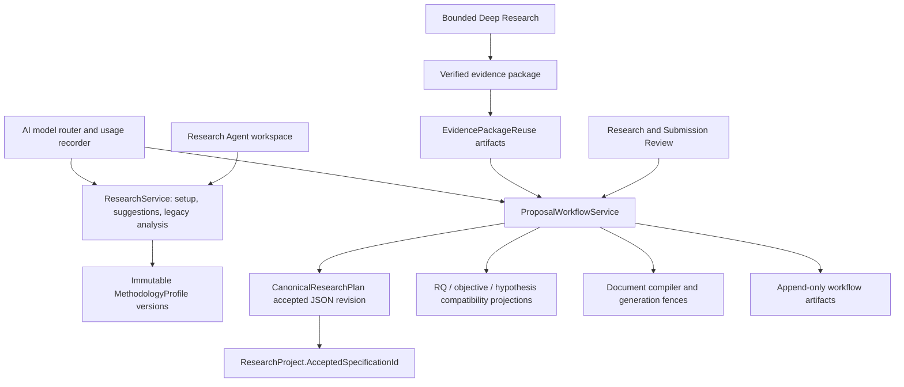

# Research Design Agent — Phase 0 repository audit

Date: 2026-10-05. Scope: the attached Research Design Agent specification, evaluated against the current frontend and sibling .NET backend. **Audit only: no application code, migrations, database changes, or provider calls are authorized by this request.**

## Decision

Extend the existing accepted `CanonicalResearchPlan.SpecificationJson` and its `ResearchSpecificationInput` / `StudySpecification` contracts. Do not introduce a second authoritative `ResearchDesignSpecification` entity. A Research Design Agent should produce draft recommendations, deterministic findings, and a proposed revision; explicit acceptance should use the existing immutable specification workflow.

The platform has a substantial foundation: immutable specification revisions, stable RQ/objective IDs, reference validation, deterministic sample calculations, compiler study contracts, evidence artifacts, verified Deep Research packages, and generation fences. It does **not** yet have the requested standalone, bounded design agent or a comprehensive methodological compatibility validator. Treating the existing methodology suggestion as that agent would overstate its capabilities.

The authority decision is sufficiently clear for an implementation plan: the accepted specification pointer governs the strict workflow. The unresolved implementation decision is how to make methodology confirmation and design acceptance atomic without leaving two independently editable authorities. Resolve that before building the agent's acceptance endpoint.

## Evidence and limitations

Both repositories contain `.codegraph`. CodeGraph was consulted first. Backend exploration subsequently failed with `unable to open database file`, and reported stale indexed files; findings below use live source reads and targeted searches. Frontend graph exploration was supplemented with live source reads. Line anchors describe this checkout and can move as ongoing work changes it.

Both working trees contain substantial existing modifications and new files, including compiler, workflow, Deep Research, and methodology recommendation work. This audit includes their current source; it does not presume a clean branch, deployment, or production schema. No tests were run for this documentation-only audit. Existing test files demonstrate coverage areas, not passing results in this turn. No generated proposal document was re-audited here, and no runtime performance diagnosis is claimed.

Backend paths below are relative to `../Humaniser`; frontend paths are relative to this repository. No secret-bearing configuration values are needed for the recommendations.

## A. Existing architecture map

The diagram shows existing components, not a claim that all legacy AI calls explicitly consume routing policy. `ResearchService.RecommendMethodologyAsync` calls generic completion without selecting the capability policy itself.

| Component | Classification | Observed implementation / consequence |
|---|---|---|
| Accepted specification authority | EXISTS | `CanonicalResearchPlan.cs`; `ResearchProject.cs:132`; `ProposalWorkflowService.cs:196`. Immutable accepted JSON, hash, schema version, and owning-project pointer. |
| Methodology confirmation | PARTIAL | `ResearchService.cs:222`. Immutable profiles, but free-form subtype and narrow change detection. |
| Methodology recommendation | PARTIAL | `ResearchService.cs:659`; `ResearchAgentPage.tsx:1010`. Provider suggestion plus local keyword fallback; no complete persisted design run. |
| RQ/objective graph | PARTIAL | `ProposalWorkflowDtos.cs`; acceptance projects stable IDs into legacy tables. Links do not yet span every collection/instrument/output requirement. |
| Sample calculations | PARTIAL | `ProposalWorkflowPolicy.Calculate`. Deterministic, guarded formulas for two supported quantitative cases and qualitative rationale. |
| Legacy analysis plan | BROKEN for canonical design reuse | `ResearchService.cs:13314`; `ProjectAnalysisPlan.cs`. GET can generate/persist; cached rows have no specification fingerprint. It remains a legacy feature, not a safe design authority. |
| Structured study compiler | EXISTS, PARTIAL for agent | `StudySpecification.cs`; `DocumentCompilerValidator`. Sampling adequacy, instrument provenance, intent and feasibility reasoning require extensions. |
| Evidence handoff | EXISTS, PARTIAL | `VerifiedEvidencePackageDto.cs`; `EvidencePackageReuseContext.cs`. Verified bounded handoff exists; typed design-specific needs are missing. |
| Model routing / usage | EXISTS, PARTIAL wiring | `IAiModelRouter`, `AiModelRouter`, `ClaudeService`, usage recorder. Agent-specific budgets, stage metrics, and routing integration remain to build. |
| Standalone Research Design API / UI | MISSING | Current surfaces are methodology setup and specification editor, not the requested agent lifecycle. |
| Methodological taxonomy | MISSING as closed canonical taxonomy | Existing family and subtype strings are insufficient for design-specific compatibility. |

## B. Current canonical research-design sources

1. **Accepted authority:** `ResearchProject.AcceptedSpecificationId` resolves to an owned `CanonicalResearchPlan` containing `SpecificationJson`, `SpecificationHash`, `SpecificationSchemaVersion`, and `MethodologyProfileId`. `ProposalWorkflowService.EnsureCurrent` at line 158 rejects a methodology version mismatch. Acceptance requires the expected prior revision and explicit legacy reconciliation.
2. **Confirmed methodology input:** `CurrentMethodologyProfileId` references immutable `MethodologyProfile` versions. The accepted revision binds one profile, but confirmation can happen separately. Until acceptance, a confirmed profile is an input, not acceptance of an entire valid design.
3. **Compatibility projections:** `ProjectResearchQuestion`, `ProjectObjective`, `ProjectHypothesis`, project scalar fields, and plan snapshot fields. Acceptance updates/retires these rows. They must not override accepted JSON.
4. **Draft/import material:** project setup fields, `ProjectFact`, prose sections, recommendation JSON in section content, and cached `ProjectAnalysisPlan`. These are possible reconciliation inputs only.
5. **Evidence authority:** immutable, project-scoped evidence artifacts and verified package hashes establish provenance; a recommendation never upgrades an abstract or model assertion into verified evidence.

Historical canonical plans with schema version 0 and no accepted specification JSON are snapshots, not accepted agent designs. Do not silently upgrade them or infer informed acceptance.

## C. Existing components to reuse

- Existing canonical revision, expected-revision concurrency check, project ownership checks, and transaction/lock path in `ProposalWorkflowService`.
- `ResearchSpecificationInput`, objective edge arrays, hypothesis applicability, `StudySpecification`, instrument items, eligibility predicates, timeline, budget, data lifecycle, and unresolved needs.
- `ProposalWorkflowPolicy` deterministic calculations, ID/reference validation, hashing, and serialization; extend rather than replace its working safeguards.
- Compiler validators and output contracts, generation/specification/corpus fences, cancellation, workflow artifacts, and stale-section flags.
- `IAiModelRouter` with `AiCapability.Classify` and `ComplexReasoning`; generic completion/token counting and provider usage recording; existing atomic credit reservation pattern in workflow review.
- Deep Research application-controlled actions, verified package, provider outcome reporting, evidence reuse, and bounded session/checkpoint mechanisms.
- `ResearchSpecificationEditor`, `StudyParametersEditor`, evidence reuse panel, API clients, existing authenticated routes, and feedback/loading patterns.
- Existing methodology, CRUD concurrency, analysis specificity, workflow architecture/Postgres, and AI routing test suites.

## D. Duplicated and obsolete components

| Representation | Current finding | Disposition |
|---|---|---|
| Backend AI methodology recommendation and frontend keyword recommendation | DUPLICATED decision behavior; fallback is actively used | Retain temporarily as explicitly labelled preliminary heuristic. It must not silently masquerade as a validated recommendation after provider failure. |
| Recommendation in `sectionContent` | PARTIAL persistence; prose storage doubles as recommendation storage | Migrate to typed recommendation artifacts with input/policy fingerprints; import old values as drafts only. |
| Confirmed methodology vs accepted specification | PARTIAL reconciliation | Accept one coherent revision and bound profile atomically; block conflicting independent edits after acceptance. |
| Accepted analysis records vs `ProjectAnalysisPlan` | DUPLICATED methodological representation | Derive legacy display from accepted analysis IDs where accepted state exists; do not generate a separate plan there. |
| `SamplingContract` vs `StudySpecification.SamplePlan` | Potential duplicated count authority | Define a discriminated plan: quantitative calculated requirement, qualitative adaptive adequacy, mixed strand plans. Quantitative target counts must have one source. |
| Snapshot RQ/objective JSON vs accepted JSON vs projection tables | Intentional compatibility duplication | Preserve for historical compatibility; document accepted JSON as authority and prohibit independent writes. |
| Domain/compiler instrument concepts | Potential semantic duplication | Share IDs and mapping; inspect ownership before extending. Do not create a third instrument registry. |

No existing component is proven safe to delete in Phase 0. “Obsolete” is conditional: retire legacy generation only after consumers use the canonical path and parity tests pass.

## E. Missing capabilities

Closed intent/design taxonomies; design-aware typed questions and phenomena; candidate comparison; complete alignment matrix; collection/instrument/operationalisation edges; analysis compatibility beyond strand labels; confounder rationale; primary-analysis sample adequacy; assumption provenance and sensitivity; mixed-strand integration; feasible versus ideal choices; typed ethics risks; design evidence needs; persisted run lifecycle; revision-aware impact analysis; complete fingerprinted caching; standalone API/UI; and golden methodological evaluations.

Some information can already be stored as free text or generic unresolved needs. Storage capacity is not equivalent to deterministic validation or methodological correctness.

## F. Current methodology generation flow

`ResearchAgentPage.tsx:1010` builds title/topic/context input. It calls `researchApi.recommendMethodology`; on failure it persists the local `recommendMethodology` heuristic. The browser stores the result under a section-content key. Its fingerprint covers title/topic/location/population/academic level, **not** structured RQ/objective edits, evidence package version, constraints, or policy/model versions.

`ResearchService.RecommendMethodologyAsync:659` loads owned project inputs, RQs and non-retired objectives, builds a prompt, and calls `_claude.CompleteAsync` labelled `methodology-recommendation`. The inspected RQ query does not exclude retired questions. Parsing normalizes some invalid values to `Undetermined` / `Low`. Parse-failure logging includes a raw response excerpt; replace this with sanitized diagnostics rather than research text logging.

The output includes approach, free-text design, rationale, signals, assumptions, missing information, confidence, an alternative, and clarification. It is useful advisory behavior but lacks canonical alignment, evidence validation, feasibility gates, complete candidate comparison, and persisted run budgets.

`ConfirmMethodologyAsync:222` versions a profile and mirrors legacy project labels. `isGenuineChange` checks only approach type. The preview at line 298 has the same limitation. A cross-sectional-to-longitudinal or analysis change within the same approach can escape that legacy impact path. Strict workflow version checks offer a separate guard but do not provide a precise impact matrix.

## G. Current RQ/objective flow

Legacy CRUD starts around `ResearchService.cs:12771`. Create/update/delete guards reject direct edits when an accepted specification exists and require reconciliation through the revision workflow. This is a valuable existing boundary.

`SpecificationQuestion` currently has ID and text. `SpecificationObjective` links question, construct, data source, and analysis IDs and records general/specific type. `ProposalWorkflowPolicy.Validate` verifies nonempty IDs, references, required links, and coverage of every question by an objective. `AcceptAsync:196` updates compatibility rows and retires omitted IDs; stable identifiers must survive revisions.

Missing: primary/secondary priority, question intent/type, expected data and output, explicit collection/instrument nodes, and compatibility of each traversed edge. Text overlap is not alignment. The proposed matrix must be derived from canonical edges rather than another manually editable JSON copy.

## H. Current sample-size logic

`ProposalWorkflowPolicy.Calculate` supports:

- `ProportionPrecision`: specified confidence, margin, proportion; optional finite population correction.
- `TwoIndependentMeans`: positive standardized effect, supported power/confidence, balanced two-group normal approximation; total requirement across both groups.
- Design-effect and response-rate inflation, finite-number/overflow checks and ceiling.
- `Qualitative`: requires frame/rationale and passes without inventing a numeric adequacy claim.
- Unsupported designs return `Unknown`, requiring reviewed external calculation.

This is an existing deterministic calculator, not complete primary-analysis power planning. The two-means approximation must remain labelled as such; do not claim exact t-test power. Correlation, paired/repeated designs, regression, categorical contrasts, clusters/ICC, unequal allocation, and other requested cases need explicit support or an unresolved requirement. Do not reuse prevalence precision for correlation merely because the intended collection is a survey.

Add estimand/test linkage, parameter provenance, formula version, alpha/power, allocation, clustering where applicable, attrition versus nonresponse, sensitivity scenarios, and rounding rules. Qualitative adequacy must record information-power/stopping rationale and review milestones. Mixed methods require strand-specific adequacy and their relationship. A fixed minimum/maximum band is not proof of adequacy.

## I. Current analysis-plan logic

`GetAnalysisPlanAsync:13314` returns cached project rows if any exist, without checking accepted revision or relevant input fingerprint. Otherwise this GET can call `GenerateAnalysisPlanInternalAsync:13348` and persist model output.

The qualitative branch takes objective prose, truncates it, and uses fields such as `InferentialTest` for trustworthiness. Quantitative and mixed methods share the hypothesis-oriented branch. `ProjectAnalysisPlan` stores objective text and free-text methods/variables/software, defaulting software to SPSS; it lacks canonical question/objective IDs and revision references.

The accepted contract has separate `SpecificationAnalysis` records with method, assumptions, missing-data handling, and strand. Validation checks required fields and strand coherence, but does not prove method suitability for data scale, independence, longitudinal structure, qualitative tradition, or intended inference.

Upgrade accepted analysis contracts; make reads read-only; expose regeneration/revision as explicit commands. Never infer an executable analysis solely from a software label. Keep the Data Analyst execution boundary separate from design planning.

## J. Deep Research integration opportunities

`VerifiedEvidencePackageDto` already includes scope, question IDs, accepted sources, potential gaps, insufficient evidence, contradictions, limitations, search coverage, provider outcomes, completion reason, usage and content hash. `EvidencePackageReuseContext` loads attached handoffs and review fingerprints. Reuse these instead of implementing a new search/citation agent.

Introduce typed design evidence needs, linked to component IDs: design justification, instrument validity/permission, effect estimate, population/frame estimate, construct operationalisation, confounder rationale, qualitative tradition, or ethical/feasibility requirement. Each need records scope, acceptable evidence, current status, source/package references, and the decision it blocks.

An application-controlled adapter may submit one bounded handoff with explicit search/call/token/time limits. A returned package triggers revalidation of affected decisions; it does not auto-accept a design. Prevent cyclic design→research→design recursion with run/need IDs and an attempt cap. Provider failure means unavailable evidence, never evidence absence or a defensible research gap. Contradictions and limitations remain visible.

## K. Proposed specification mapping

`ResearchDesignSpecification` should be an API view of the existing accepted specification plus derived findings, not a second aggregate. Draft recommendation payloads may contain candidate designs; acceptance writes one canonical revision.

| Requested concept | Existing owner | Proposed extension |
|---|---|---|
| Version/hash/created metadata | `CanonicalResearchPlan` | Reuse; accepted revisions remain immutable. Draft timestamps belong to draft/run artifacts. |
| Problem/level/context | `ResearchSpecificationInput` | Reuse; add Honours consistently; conditional requirements by supported family. |
| Intent/paradigm/approach/design/rationale | Confirmed profile + study subtype | Typed `Study.Design` decision contract; profile labels become compatibility projection on acceptance. |
| RQs | `SpecificationQuestion[]` | Add type, priority, context/time/data requirements and expected outputs using existing IDs. |
| Objectives | Existing objective edge arrays | Preserve; add collection/instrument/output edges where needed. |
| Hypotheses | Existing records/applicability | Extend rationale/provenance; enforce institutional and design conditions. |
| Variables/constructs/phenomena | `SpecificationConstruct[]` | Discriminated measurement/phenomenon contract; do not force numeric scale/unit onto qualitative phenomena. |
| Framework | Existing text | Optional/applicability-aware typed coverage links and source provenance. |
| Population/unit/setting | Existing text + eligibility | Target/access population and setting details; no duplicated population text authority. |
| Sampling/sample plan | `SamplingContract` + study sample plan | Design-specific union and mixed strand plans; one authoritative requirement per strand. |
| Data/instruments | Existing sources and study instruments | Add operationalisation, validity/provenance/permission, collection step IDs and source relationships. |
| Analysis/missingness/quality | Existing analyses | Typed methods, inputs, assumptions, alternatives and design-specific quality strategy. |
| Ethics/feasibility | Study lifecycle, budget, timeline | Typed risks, approval dependencies, access/tool/ability constraints and feasibility findings. |
| Evidence dependencies | Existing artifacts/packages | Reference immutable IDs/hashes; typed needs; no copied entire corpus. |
| Alignment/findings/confidence | Existing findings primitives | Derive matrix; persist validation artifacts bound to revision, policy, and evidence fingerprint. Confidence cannot override blockers. |

Use a new explicitly versioned schema only after compatibility design is agreed. A proposed next schema must not make existing schema-2 revisions unreadable. Unsupported historical/humanities/synthesis designs should return `RequiresInput` with an explicit support boundary until their validators exist, rather than forcing a quantitative template.

## L. Proposed state machine

Main path: `Created → LoadingResearchState → ClassifyingIntent → GeneratingCandidates → EvaluatingCandidates → BuildingDesign → ValidatingAlignment → ValidatingAnalysis → ValidatingFeasibility → ValidatingEvidence → ReadyForReview → Accepted`.

Side states: `RequiresInput`, `RequiresEvidence`, `Failed`, `Cancelled`, `BudgetExhausted`, `Superseded`.

- Every transition records run ID, project ID, input fingerprint, stage, attempt and reason. Application code owns transitions, not model output.
- Missing critical inputs pause with specific questions. Evidence needs pause with typed requests and bounded handoff.
- Resumption rechecks ownership, budget, cancellation, revision, evidence hash and policy version. Changed inputs supersede a run; they do not resume it against different state.
- Provider retries are bounded and budgeted. Restart recovery reads persisted checkpoints and uses idempotent operations; no reliance on a browser request staying connected.
- `ReadyForReview` requires validation completion and no blockers. Only an explicit acceptance command can produce `Accepted`; recommendations cannot approve themselves.

## M. Deterministic rule catalogue

Findings need stable rule ID, severity (`BLOCKER`, `MAJOR`, `MINOR`, `WARNING`, `PASS`), component IDs, observed/expected values, evidence references, and repair guidance. Acceptance requires zero blockers and satisfaction of all mandatory links; define which major findings require explicit resolution or acknowledgement by policy.

| Rule family | Required validation / example |
|---|---|
| Authority/security | Owned project and referenced records; expected revision; accepted JSON is authoritative; evidence references belong to permitted project/session. |
| Shape/taxonomy | Closed enums, valid discriminated combinations, length/count limits, unique stable IDs; unknown is unresolved, not a default valid design. |
| Intent/design | Association does not imply causal effect; prediction is not explanation; cross-sectional observations alone do not authorize causal claims. |
| RQ coverage | Every primary RQ has objective, relevant construct/phenomenon, obtainable data, collection, instrument where applicable, analysis, and output. |
| Objective edges | Referenced nodes exist, strand and population/time scope agree; general-objective rules must not mechanically copy every specific-objective edge requirement. |
| Hypotheses | Applicability and rationale required; no automatic hypotheses for qualitative designs; applicable quantitative hypotheses link compatible outcomes/tests. |
| Measurement | Variable role, scale/unit where meaningful, operationalisation and instrument linkage; qualitative phenomena use exploration/coding contracts. |
| Instrument provenance | Claimed validated scales require verifiable version/context evidence; adaptation/permission unresolved explicitly. Never fabricate psychometrics. |
| Population/sample | Target versus accessible population, unit, setting, inclusion/exclusion and frame agree; sampling matches recruitment/access constraints. |
| Adequacy | Formula matches primary estimand/test; required parameters and provenance exist; supported formula version and sensitivity; qualitative review/stopping rationale. |
| Analysis | Method compatible with outcome scale, predictor structure, dependence/time structure and design; assumptions and fallback are explicit. |
| Missingness | Assess expected missingness and mechanism uncertainty; choose justified handling. No blanket imputation or automatic MICE. |
| Confounding | Each adjustment variable has pre-specified rationale/provenance; detect incompatible mediator/collider assumptions where graph information is supplied. Do not claim causal graph correctness from labels. |
| Qualitative quality | Tradition, recruitment, collection and analytical procedure cohere; quality practices are justified rather than interchangeable checklists. |
| Mixed methods | Separate RQs/data/samples/analysis by strand; explicit timing, priority, integration point/method and joint interpretation. |
| Framework coverage | Applicable constructs are measured/explored and mapped; framework requirement is conditional, not universal. |
| Evidence | Support/contradiction/insufficiency distinguished; no source verification inferred from model text or failed providers. |
| Feasibility | Timeline, recruitment/access, cost, tools, skills and academic level constraints; impossible plans block, uncertainty is visible. |
| Ethics | Design-specific risks, consent/privacy/vulnerability and approval prerequisites; no invented committee approval. |
| Revision impact | Changed core fields invalidate affected validations/sections and dependent evidence needs; stale results cannot confer acceptance. |
| Reliability | Idempotency, finite retries, cancellation, durable checkpoints, maximum calls/tokens/time/cost, no uncontrolled evidence loops. |
| Presentation | Show unresolved assumptions, evidence provenance, candidate rationale and clear stage status; never display “validated” for a heuristic fallback. |

Existing policy corrections: add Honours end to end; make framework/geography and scale/unit obligations conditional; extend method compatibility beyond strand labels. Keep existing cross-project checks, formula guards, and reconciliation gates.

## N. LLM responsibilities

The model may infer tentative intent from ambiguous wording, propose at most 2–3 feasible candidates, explain tradeoffs, formulate clarification questions, suggest typed design components, and identify unresolved methodological judgments. Return concise rationale, assumptions and evidence references, not private chain-of-thought.

The model must not calculate authoritative sample requirements, approve designs, invent instrument validity/effect assumptions/citations, select unbounded external actions, silently alter accepted state, execute statistics, or write proposal chapters. Deterministic code validates shape, references, calculations, budgets, transitions and acceptance. Specialist judgments unsupported by rules/evidence remain unresolved rather than being falsely certified.

## O. Model-routing plan

Resolve `AiCapability.Classify` only when classification cannot be settled deterministically; resolve `ComplexReasoning` for the bounded candidate/design judgment. Use existing `IAiModelRouter.Resolve` with authenticated plan and documented complexity hint. Do not hardcode model names in the new service.

Apply the returned input/output ceilings, timeout, temperature, prompt version, cache eligibility and fallback policy; selecting a model alone is insufficient. Current `ClaudeService.CompleteAsync:528` uses the configured default unless overridden, so pass the resolved policy through an explicit orchestration adapter. Do not add another router or provider client. Provider/schema failure is a typed run outcome, not silent local acceptance.

## P. Persistence and versioning plan

1. Accepted design remains an immutable `CanonicalResearchPlan` revision, with project pointer and bound profile. Preserve prior revisions and accepted generation references.
2. Store typed recommendation and validation snapshots in existing `ProposalWorkflowArtifact` infrastructure where suitable; bind them to full input/policy/prompt/evidence fingerprints.
3. Operational run state is not canonical research truth. Evaluate a dedicated run/checkpoint record only if existing infrastructure cannot support durable lease, cancellation, idempotency, budget accounting and efficient status reads. Append-only artifacts alone are not a mutable lease mechanism; do not pretend otherwise.
4. Acceptance atomically checks expected revision, current inputs and validation fingerprint; creates/binds a coherent methodology profile, canonical revision and compatibility projections; records impacts and invalidates dependent results.
5. Draft editing creates proposals for a new version, never overwrites an accepted JSON payload. Cache hits require current authorization and complete fingerprint equality.
6. Replace approach-only impact detection with component dependency traversal. Conservative whole-document stale marking is a safe fallback until precise mappings are validated.

## Q. API plan

Create a dedicated `IResearchDesignService` / `ResearchDesignService` and versioned controller under `/api/v1/research/projects/{projectId}/design`; avoid adding another large feature to `ResearchService`.

| Operation | Proposed endpoint / semantics |
|---|---|
| Recommend | `POST /recommendations`: idempotency key, expected revision, constraint changes; return durable run handle. |
| Status/result | `GET /runs/{runId}`: stage, budget usage, actionable reason and candidate/result; no generation side effects. |
| Current design | `GET /`: accepted view and separately labelled draft/recommendation. |
| Validate | `POST /validate`: typed draft, expected revision; return policy-versioned findings and matrix. |
| Accept | `POST /accept`: current validation/run reference and expected revision; reuse canonical acceptance transaction. |
| Revise | `POST /revisions`: draft revision and impact preview; does not auto-accept. |
| Alignment/issues | `GET /alignment`, `GET /issues`: derived revision-bound views. |
| Cancel | `POST /runs/{runId}/cancel`: durable cancellation with ownership check. |

Use existing error conventions; stale concurrency should map to a conflict response, missing input/evidence to actionable domain states, not generic server failures. UI provides Accept Design, Compare Alternatives and Change Constraints, with editable structured components and visible unresolved findings. No implementation-only concepts in normal user flows.

## R. Cost and token plan

Default execution: deterministic loading/classification/validation first; one bounded reasoning call; a separately capped targeted escalation only for a recorded unresolved issue. Revalidate cached results without a provider call when fingerprints match. Any additional call must consume the remaining run allowance; provider retries and fallbacks count too.

Compact context includes relevant canonical fields, primary RQ/objective edges, constraints, candidate taxonomy subset and selected verified evidence excerpts. Exclude whole proposals, all abstracts, irrelevant history and raw provider logs. Count prompt components before dispatch using existing token-counting capability; distinguish counted/estimated tokens from actual usage.

Set configurable per-run call/input/output/time/cost caps and reserve credits atomically before calls. Derive cost from current internal pricing metadata; missing cost information is unknown, not zero. Record actual input/output/cache tokens, estimated versus actual cost completeness, retries, stage latency, cancellation and correlation IDs. Extend existing usage recording instead of starting a parallel ledger. Log categorical summaries and hashes, not research content.

ETA should be shown only when meaningful observations support it. Otherwise show stage, elapsed time and bounded waiting/retry status. A spinner without a remaining-time estimate is not evidence of progress.

## S. Test plan

Reuse current suites: `MethodologyRecommendationTests`, `MethodologyEnforcementTests`, `ObjectivesAndResearchQuestionsCrudTests`, objective/RQ concurrency tests, `AnalysisPlanSpecificityTests`, `AiModelRouterTests`, `ProposalWorkflowArchitectureTests`, and `ProposalWorkflowPostgresTests`.

Build the requested 55-case acceptance matrix as versioned fixtures: 10 quantitative, 5 qualitative, 3 mixed, 3 synthesis/historical/other, 19 contradiction cases, 5 revision-impact cases and 10 reliability/security cases. Each fixture records expected design support boundary, links, deterministic findings and acceptable judgment outcomes.

- Quantitative cases cover precision versus power, causal overclaiming, repeated/clustered data, variable-scale compatibility and unsupported formula outcomes.
- Qualitative cases cover tradition alignment, phenomenon rather than forced variables, adequacy rationale and inappropriate hypotheses.
- Mixed cases require separate strands and real integration rather than “survey plus interview” labels.
- Other families verify supported contracts or explicit `RequiresInput`, never forced quantitative acceptance.
- Contradictions exercise broken links, unsupported instrument validity, invalid sample assumptions, inaccessible populations, unexplained confounders, missingness defaults and infeasible ethics/timelines.
- Changes include subtype-only, population/frame, primary RQ, instrument and analysis changes; prove accepted revisions remain immutable and cache/sections become stale.
- Reliability/security include cross-project IDs, concurrent acceptance, duplicate commands, restart recovery, cancellation, malformed/fenced/truncated JSON, provider failure, budget exhaustion, evidence-loop prevention and privacy-safe logs.

Pure deterministic tests should not need paid models. Add disposable-Postgres integration for transactions, ownership, immutable revisions and concurrent acceptance; API tests for read-only GETs; frontend tests for stale/failed/heuristic states and acceptance gates. Maintain curated golden model evaluations with methodological scoring and human-reviewed expectations. Valid JSON alone is not a quality metric. Run model/prompt changes against golden fixtures before rollout.

## T. Migration and conflict risks

- Compiler/workflow migrations were applied in the preceding task; this audit does not create or apply new migrations or verify current database state. Do not regenerate unrelated migration changes from a dirty snapshot.
- Historical schema-0 plans and legacy-only projects must remain readable and explicitly unreconciled. Backfill may prepare draft mappings, not accepted designs.
- New schema readers must handle current accepted versions; preserve hashes of historical payloads. Never rewrite immutable JSON in place to add defaults.
- Honours requires coordinated domain enum, validation, API/UI and persisted representation review; do not infer its storage migration from a dropdown alone.
- Free-text design aliases need explicit mapping and ambiguity reporting. Unsupported labels must not silently resolve to the closest design.
- Atomic profile/design acceptance must preserve locks, ownership, expected-revision checks and active generation fences.
- Cached legacy analysis cannot be imported as validated canonical analysis without reconciliation.
- Taxonomy expansion must account for proposal outlines that assume empirical/quantitative sections; synthesis/history cannot be made valid merely by adding enum values.
- Evidence attachment, expiry/retraction and scope changes invalidate design support; package sufficiency is not blanket design validity.
- Existing work in both repositories overlaps the proposed files. Inspect diffs and preserve ongoing changes before implementation; no wholesale replacement of services, DTOs or snapshots.

## U. Exact files/classes expected to change

These are implementation targets, not changes made by this audit. New paths are proposed explicitly.

| Existing backend file / class | Purpose |
|---|---|
| `HumaniseAI.Domain/Entities/CanonicalResearchPlan.cs` | Preserve accepted authority; add metadata only if existing fields are insufficient. |
| `HumaniseAI.Domain/Entities/MethodologyProfile.cs` | Controlled compatibility mapping and atomic acceptance binding. |
| `HumaniseAI.Domain/Entities/ResearchProject.cs` | Preserve accepted pointer/current profile and workflow fences. |
| `HumaniseAI.Domain/Enums/AcademicLevel.cs` | Review/add Honours with storage compatibility. |
| `HumaniseAI.Application/DTOs/Research/ProposalWorkflowDtos.cs` | Enrich existing questions/constructs/analyses/sampling contracts. |
| `HumaniseAI.Application/DTOs/Research/StudySpecification.cs` | Typed design decisions, feasibility/ethics/evidence needs and conditional study contracts. |
| `HumaniseAI.Infrastructure/Services/ProposalWorkflowPolicy.cs` | Conditional requirements, compatibility rules and design-aware calculations. |
| `HumaniseAI.Infrastructure/Services/ProposalWorkflowService.cs` | Atomic accepted revision and dependency impact integration. |
| `HumaniseAI.Infrastructure/Services/ResearchService.cs` | Delegate recommendation; retire accepted-state legacy generation; correct subtype impact and retired-RQ handling. |
| `HumaniseAI.Domain/Entities/ProjectAnalysisPlan.cs` | Compatibility projection metadata only if still needed; not new authority. |
| `HumaniseAI.Infrastructure/Services/DeepResearch/EvidencePackageReuseContext.cs` | Reuse package references/fingerprints for design validation. |
| `HumaniseAI.Application/DTOs/DeepResearch/VerifiedEvidencePackageDto.cs` | Prefer reuse unchanged; extend only for an actual missing shared requirement. |
| `HumaniseAI.Application/Services/IAiModelRouter.cs`; `HumaniseAI.Infrastructure/Services/AiModelRouter.cs` | Existing routing integration; new router unnecessary. |
| `HumaniseAI.API/Controllers/ResearchController.cs` | Legacy endpoint delegation/deprecation compatibility. |
| `HumaniseAI.Infrastructure/DependencyInjection.cs` | Register dedicated design orchestration/validators. |

Proposed new backend files: `HumaniseAI.Application/Services/IResearchDesignService.cs`; `HumaniseAI.Application/DTOs/Research/ResearchDesignDtos.cs`; `HumaniseAI.Infrastructure/Services/ResearchDesign/ResearchDesignService.cs`, `ResearchDesignRules.cs`, `ResearchDesignContextBuilder.cs`, `ResearchDesignImpactAnalyzer.cs`, `ResearchDesignEvidenceAdapter.cs`; `HumaniseAI.API/Controllers/ResearchDesignController.cs`. A run persistence entity/configuration and migration are conditional on the operational-store decision in P, not automatically required to store accepted design JSON.

Existing frontend targets: `src/api/research.ts`, `src/api/proposalWorkflow.ts`, `src/pages/app/ResearchAgentPage.tsx`, `src/pages/app/ResearchDashboardPage.tsx`, `src/pages/app/ProposalWorkflowPage.tsx`, `src/components/research-agent/ResearchSpecificationEditor.tsx`, `src/components/research-agent/StudyParametersEditor.tsx`, `src/lib/methodologyRecommendation.ts`, and route/navigation registration. Proposed new files: `src/api/researchDesign.ts`, `src/pages/app/ResearchDesignPage.tsx`, and focused candidate/alignment/issues components. Reuse the specification editor rather than fork a second incompatible form.

Extend existing integration tests listed in S; add focused `ResearchDesignRulesTests`, `ResearchDesignLifecycleTests`, `ResearchDesignPostgresTests` and frontend state/acceptance tests. Database configuration/snapshot/migration paths are implementation-stage changes only after the schema delta is established.

## V. Recommended phased implementation order

| Phase | Deliverable | Exit gate |
|---|---|---|
| 0 — this audit | Repository map, authority decision, gap/rule plan | User reviews audit; no application implementation in this phase. |
| 1 — domain foundation | Reuse canonical schema, typed taxonomies, discriminated family contracts, stable links and deterministic validation; no LLM | Supported fixture families validate correctly; legacy revisions remain readable. |
| 2 — methodological safeguards | Primary-analysis adequacy, compatibility, feasibility, ethics, dependency impact | Contradiction and change-impact fixtures pass; unsupported cases pause explicitly. |
| 3 — bounded reasoning | Compact context, existing routing/credits, one-call candidate reasoning, privacy-safe usage | Caps and failure handling demonstrated; golden methodological evaluations meet reviewed criteria. |
| 4 — durable lifecycle | Runs/checkpoints, fingerprint cache, atomic profile/specification acceptance, revisions | Restart, cancellation, concurrency and stale-input tests pass. |
| 5 — evidence handoff | Typed needs and bounded reuse/Deep Research adapter | No recursive loops or false gaps; changed evidence invalidates dependent findings. |
| 6 — API | Dedicated versioned service/controller and read-only query endpoints | Ownership, idempotency, conflict and lifecycle contract tests pass. |
| 7 — UX | Standalone design flow, candidate comparison, editable canonical components and clear issues | Users can resolve needs and accept one coherent design; fallback never looks validated. |
| 8 — proposal integration | Writer consumes accepted relevant subset; reviewer detects design/prose drift; compatibility screens share authority | Standalone gates pass first; generation/review remains bound to revision and evidence fingerprints. |

Implementation should begin only after review of this audit, as explicitly requested in the attachment. The first engineering change should establish typed deterministic contracts and their compatibility policy, not introduce another LLM prompt or canonical design table.
